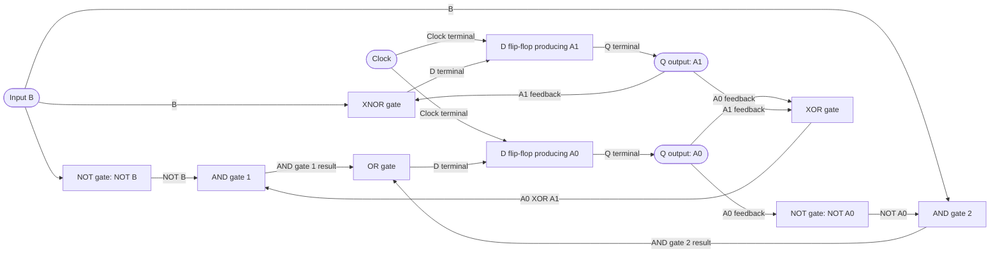

# Two-Output Sequential Circuit

**External inputs:** `B` and `Clock`, both 1 bit.
**Outputs:** `A0` and `A1`, both 1 bit, taken from the flip-flops' Q terminals.

Each gate below is a separate component. Each D flip-flop has a D input,
a Clock input, and a Q output. Wires from Q back to gates are feedback wires,
not additional external inputs. D is the value stored at the next rising clock edge.

Draw each AND, OR, XOR, and XNOR gate with two incoming wires on its left:
one upper and one lower. These are drawing positions, not named pins.
Each NOT gate has only one incoming wire. Gate outputs leave on the right.

## Circuit Diagram

## Draw Each Wire

Draw two D flip-flops on the right. Label the top Q wire `A0` and the bottom Q wire `A1`.
Place `B` and `Clock` on the left. Then connect these wires in order:

| Wire | From | To |
|---|---|---|
| 1 | Input B | NOT B gate input |
| 2 | NOT B gate output | AND gate 1, lower incoming wire |
| 3 | Input B, branched | AND gate 2, upper incoming wire |
| 4 | Input B, branched | XNOR gate, upper incoming wire |
| 5 | Clock | Top D flip-flop, Clock terminal |
| 6 | Clock, branched | Bottom D flip-flop, Clock terminal |
| 7 | Top D flip-flop, Q terminal | Output A0 |
| 8 | A0 wire, branched | XOR gate, upper incoming wire |
| 9 | A0 wire, branched | NOT A0 gate input |
| 10 | NOT A0 gate output | AND gate 2, lower incoming wire |
| 11 | Bottom D flip-flop, Q terminal | Output A1 |
| 12 | A1 wire, branched | XOR gate, lower incoming wire |
| 13 | A1 wire, branched | XNOR gate, lower incoming wire |
| 14 | XOR gate output | AND gate 1, upper incoming wire |
| 15 | AND gate 1 output | OR gate, upper incoming wire |
| 16 | AND gate 2 output | OR gate, lower incoming wire |
| 17 | OR gate output | Top D flip-flop, D terminal |
| 18 | XNOR gate output | Bottom D flip-flop, D terminal |

A branch splits one wire to multiple destinations. Do not connect A0 to A1.
On paper, use a dot for connected branches; crossing wires without a dot are not connected.

## Check Against the Assignment

| B | Current A0 | Current A1 | Next A0 | Next A1 |
|---|---|---|---|---|
| 0 | 0 | 0 | 0 | 1 |
| 0 | 0 | 1 | 1 | 0 |
| 0 | 1 | 0 | 1 | 1 |
| 0 | 1 | 1 | 0 | 0 |
| 1 | 0 | 0 | 1 | 0 |
| 1 | 0 | 1 | 1 | 1 |
| 1 | 1 | 0 | 0 | 0 |
| 1 | 1 | 1 | 0 | 1 |

Both flip-flops update simultaneously, using the old A0 and A1 values.